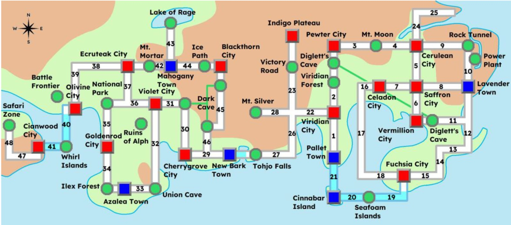
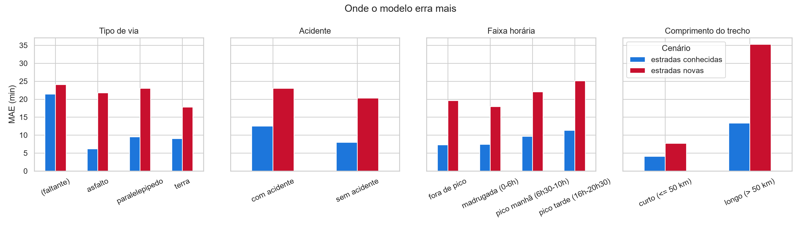

**Centro Universitário IESB** · Inteligência Artificial (MDC050) · 2026/2 · Prof. Rodrigo Gonçalves Pinto

# Um agente que evolui: da busca ao agente com LLM
## Roteirização de entregas no mundo Pokémon (Kanto e Johto)

Ana Luiza Gomes de Lima (2512130059) · Carlos Eduardo Ferreira de Souza (2512130043) · Lucas Pessoa Ranieri (2512130092)

Relatório do artefato final (Fases 2 e 3) · Brasília, 11/11/2026 · Código: <https://github.com/CarlosSouza-dev/IA-reserva>

## 1. Problema e ambiente

O agente planeja a rota de um veículo de entregas entre os **36 locais** (cidades, florestas, cavernas e ilhas) de Kanto e Johto, ligados por **45 estradas**. Os pontos e as estradas seguem o mapa esquemático do grupo (Figura 1). As distâncias, em km, vêm do mapeamento de cada rota do jogo para rodovias e balsas reais do Japão (malhas do MLIT e da NEXCO, documento de equivalência territorial do grupo). Usamos uma cidade simulada, como o enunciado permite. Todos os dados de tráfego são **sintéticos**, gerados por regras registradas no código (`src/trechos.py`).

<figure><figcaption>Figura 1. Ambiente do agente: as 45 estradas de Kanto (direita) e Johto (esquerda).</figcaption></figure>

**PEAS.**
- **Desempenho:** entregar no menor tempo, por uma rota válida, respeitando as restrições do pedido.
- **Ambiente:** o grafo, com lombadas, semáforos, tipo de via, horário e acidentes.
- **Atuadores:** escolher a próxima cidade e responder ao usuário.
- **Sensores:** origem, destino(s), **produto**, horário e restrições.

**Arquitetura.** O agente é uma peça só. O LLM (Fase 3) interpreta o pedido e chama a ferramenta `buscar_rota`. Essa ferramenta executa o A* da Fase 1 sobre um grafo cujo custo é o tempo previsto pelo modelo da Fase 2, e devolve o resultado em JSON para o LLM explicar.

## 2. Fase 1: formulação e busca (rota mais curta)

**Espaço de estados.**
- *Estado:* a cidade atual.
- *Estado inicial:* a origem.
- *Ações:* mover-se para uma cidade vizinha.
- *Transição:* leva à cidade escolhida.
- *Teste de objetivo:* chegar ao destino.
- *Custo de caminho:* a soma das distâncias.

O ambiente é totalmente observável, determinístico, sequencial, estático, discreto e de agente único. Implementamos a **busca de custo uniforme** (não informada) e o **A\***, sobre o mesmo núcleo de busca de melhor-primeiro com f(n) = g(n) + h(n). O teste de objetivo acontece quando o nó sai da fila, e uma cidade pode ser reaberta se um caminho melhor for encontrado.

**Heurística e admissibilidade.** Usamos h(n) = *escala* × distância em linha reta até o destino, com *escala* = min(custo / distância reta) sobre todas as estradas. Assim, para toda estrada (a, b), c(a, b) ≥ escala × reta(a, b). Pela desigualdade triangular, h(a) ≤ c(a, b) + h(b): a heurística é **consistente** e, portanto, **admissível**. O mesmo argumento vale quando o custo passa a ser tempo, porque a escala é recalculada sobre o grafo de tempo.

**Experimento** (rota Cianwood → Blackthorn nos três mapas e Cianwood → Lavender no grande; mediana de 30 execuções):

| Mapa | Nós | Custo (km) | Nós expandidos UCS | Nós expandidos A* | Tempo UCS / A* (ms) |
|---|---|---|---|---|---|
| Pequeno | 9 | 307 | 8 | 8 | 0,006 / 0,007 |
| Médio | 18 | 307 | 13 | 11 | 0,011 / 0,012 |
| Grande | 36 | 307 | 13 | 13 | 0,010 / 0,014 |
| Grande (Johto → Kanto) | 36 | 1.023 | 33 | 33 | 0,023 / 0,033 |

Os dois algoritmos sempre encontram o mesmo custo ótimo. Um teste automatizado confirma isso para **todos os pares** de cidades dos três mapas. O ganho do A* é pequeno porque o grafo é quase um corredor (45 estradas para 36 nós): mesmo uma heurística perfeita só poda ramos sem saída. Em grafos tão pequenos, o cálculo de h(n) faz o A* gastar mais milissegundos que a UCS.

**Correções em relação ao relatório do Marco 1.**
1. A heurística "distância reta ÷ 10" **não era admissível**: na estrada Saffron–Celadon ela estimava 10 para um custo real de 9. Ela foi substituída pela escala calibrada descrita acima.
2. O Mapa Médio tem **18 nós**, e não 21.

## 3. Fase 2: aprendizado do custo (rota mais rápida de verdade)

**Dados.** Cada estrada recebe características fixas: distância, lombadas, semáforos e tipo de via (asfalto, paralelepípedo, terra ou obras). As regras de sorteio são as seguintes:
- trechos entre dois pontos naturais são de terra, sem lombadas nem semáforos;
- trechos entre cidades são, na maioria, de asfalto, com lombadas e semáforos proporcionais à distância.

O "mundo real" é um simulador:

> tempo = deslocamento × (1 + sensibilidade × (f(h) − 1)) + 0,25·lombadas + 0,7·semáforos·f(h) + 20·acidente

Os termos são definidos assim:
- **deslocamento:** distância ÷ velocidade da via (80, 45, 35 e 25 km/h);
- **f(h):** curva de trânsito com picos às 8h (×1,8) e às 18h (×2,0);
- **sensibilidade:** quanto cada tipo de via sofre com o pico (de 1,0 no asfalto a 0,2 na terra).

O agente **não tem acesso** ao simulador. Ele vê apenas **2.700 travessias observadas** (45 estradas × 60 horários aleatórios, com 10% de chance de acidente e ruído multiplicativo de 8%).

**Pré-processamento** (base: Laboratório 4). Para ter o que tratar, apagamos de propósito 2% dos valores de lombadas, semáforos e tipo de via (resultando em 1,3% a 1,8% de faltantes). O tratamento usa:
- mediana para os faltantes numéricos e moda para o tipo de via;
- *one-hot* no tipo de via;
- hora codificada como seno e cosseno de 2π·h/24, para que 23h e 0h fiquem vizinhas;
- padronização z-score, indispensável para o k-NN.

Tudo fica dentro de um `Pipeline` do scikit-learn, ajustado **somente** nas dobras de treino, sem vazamento de dados.

**Modelos e validação.** Comparamos um baseline (média), Regressão Ridge, k-NN (k = 10), Árvore de Decisão e Floresta Aleatória, com validação cruzada de 5 dobras em **dois cenários**:
- **estradas conhecidas (KFold):** prevê uma estrada já observada em outros horários. É o uso real do agente, que só roda sobre as 45 estradas do mapa;
- **estradas novas (GroupKFold por estrada):** prevê uma estrada nunca vista. É o cenário mais exigente, usado para **escolher** o modelo.

| Modelo | MAE conhecidas (min) | R² conhecidas | MAE novas (min) | R² novas |
|---|---|---|---|---|
| **Floresta Aleatória** | **8,4** | **0,971** | **20,6** | 0,692 |
| Regressão Ridge | 20,2 | 0,872 | 21,0 | 0,771 |
| Árvore de Decisão | 9,9 | 0,960 | 24,2 | 0,636 |
| k-NN (k = 10) | 10,2 | 0,958 | 31,0 | 0,562 |
| Baseline (média) | 61,3 | −0,001 | 61,5 | −0,062 |

O tempo médio de uma travessia é 103 min. A **Floresta Aleatória** foi escolhida (menor MAE em estradas novas). Em estradas conhecidas, o erro de 8,4 min fica próximo do próprio ruído dos dados.

<figure><figcaption>Figura 2. Erro médio absoluto (MAE) da Floresta Aleatória por segmento, nos dois cenários de validação.</figcaption></figure>

**Onde o modelo erra (análise honesta).** O erro cresce em três situações:
- **trechos longos** (MAE de 35 min em estradas novas acima de 50 km). Árvores não extrapolam, e o pior caso é Tohjo Falls–Viridian (170 km), superestimado em 122 min;
- **pico da tarde**, onde o efeito do trânsito é maior e mais variável;
- **linhas com o tipo de via faltante** (MAE de 21 a 24 min nos dois cenários). Nelas o modelo superestima o tempo em cerca de 10 min, em média. A hipótese é que a moda imputada nem sempre corresponde à via real, e que o tipo de via é a característica que mais pesa no tempo.

A Ridge tem R² maior em estradas novas, mas erra mais em média: ela não captura a interação entre distância e horário de pico.

**Integração à busca.** O A* não muda: `montar_grafo_tempo` passa a usar o modelo para prever, de uma vez, os 45 tempos para a hora e os acidentes do pedido. A previsão é limitada a pelo menos 0,1 min, porque a heurística exige custo positivo. Um teste confirma que A* e UCS continuam empatando em custo ótimo em todos os pares sobre o grafo previsto. Para medir a qualidade da decisão, comparamos a rota curta (Fase 1), a rota do modelo e a melhor rota segundo o simulador (o gabarito, que o agente não conhece):

| Cenário (Pewter → Fuchsia, 312 km pela rota curta) | Rota curta (min) | Rota do modelo (min) | Economia | Igual à ótima? |
|---|---|---|---|---|
| 03h | 393,6 | 381,9 | 11,8 min | sim |
| 08h | 585,0 | 570,6 | 14,4 min | sim |
| 18h | 632,9 | 617,8 | 15,0 min | sim |
| 18h + acidente Saffron–Vermillion | 632,9 | 632,9 | — | sim |

Nos três primeiros cenários o modelo **mudou a decisão** e encontrou a rota ótima. Com o acidente, o desvio deixa de compensar, e a rota curta passa a ser a melhor. *Limitação:* o horário é uma "foto" da hora de saída; numa viagem de 10 horas, o trânsito muda ao longo do caminho.

## 4. Fase 3: agente com LLM

**Modelo.** Usamos o Qwen2.5-1.5B-Instruct, o mesmo dos Laboratórios 8 a 10, executado localmente via `transformers` (GPU no Colab), **sem chave de API**.

**Ciclo do agente** (Laboratório 9):
1. *pensar:* o LLM lê o pedido e decide se pede uma ferramenta, com saída estruturada `<tool_call>{"name", "arguments"}`;
2. *agir:* o código executa a ferramenta;
3. *observar:* o JSON do resultado volta para a conversa;
4. *responder:* o LLM explica a rota em português.

O ciclo tem limite de 3 passos.

**Ferramentas** (`src/ferramentas.py`):

| Ferramenta | O que faz |
|---|---|
| `buscar_rota` | origem, destino e/ou paradas, hora, cidades a evitar, acidentes (atraso), bloqueios (estrada removida), retorno à origem e produto. Devolve a ordem das entregas, a rota, o tempo previsto e a comparação com a rota mais curta |
| `estimar_tempo_trecho` | tempo previsto de uma estrada |
| `listar_vizinhas` | cidades ligadas diretamente a uma cidade |
| `listar_cidades` | consulta ao mapa |

Com várias entregas, a ordem é **exata** (todas as permutações) até 8 paradas. Acima disso, usa o vizinho mais próximo com melhoria 2-opt. As ferramentas aceitam apelidos e corrigem erros de digitação ("vermilion", "Cerulian", "Ilha Cinnabar"). Elas convertem "agora" para o horário de Brasília (o Colab roda em UTC) e nunca lançam exceção: os erros voltam como `{"ok": false, "erro", "sugestoes"}`, para o LLM explicar.

**Prompts versionados** (`prompts/`):
- **v1:** apenas o papel do agente.
- **v2:** regras, contrato dos argumentos, comportamento fora de escopo e exemplos (*few-shot*).
- **v3:** igual ao v2 na escolha da ferramenta, mas com **formato fixo de resposta**. Ele foi criado depois do primeiro teste real, em que o v2 acertava as chamadas, mas a explicação **inventava** uma "rota mais curta" inexistente e tempos de "1 hora e 15 minutos" por trecho.

**Barreira contra alucinação.** Antes de chegar ao usuário, a resposta do LLM passa por `verificar_fidelidade`. Todo número citado precisa vir da ferramenta ou do pedido (com tolerância de arredondamento e conversão para horas). Todo local citado precisa estar no resultado. Toda sequência "A → B" precisa ser uma estrada real. Se a resposta falhar, ela é descartada e o agente usa uma explicação gerada diretamente do resultado.

## 5. Avaliação do agente (20 pedidos de teste)

Seguindo o Laboratório 10, os 20 pedidos (`testes/pedidos_teste.json`) foram escritos junto com o resultado esperado e os critérios **antes** de rodar. Eles cobrem nove categorias: fácil, horário, várias paradas, restrição, difícil, outras ferramentas, fora do mapa, sem ferramenta e ambíguo.

Os argumentos são comparados pelo significado: "Pallet" = "Pallet Town", "18h" = 18, e as paradas são comparadas como conjunto. Uma restrição que não foi pedida conta como erro. Também verificamos se a rota é igual à calculada com os argumentos esperados e se a resposta é fiel.

| Métrica (Qwen2.5-1.5B, CPU) | Prompt v3 | Prompt v4 |
|---|---|---|
| Acerto completo | **17/20 (85%)** | 10/20 (50%) |
| Ferramenta certa (precisão e revocação em todas as classes) | 20/20 (1,0) | 14/20 |
| Argumentos certos | 17/20 | 11/20 |
| Rota igual à esperada | 10/12 | 6/12 |
| Respostas do LLM barradas pela checagem | 2 | 0 |

Com o v3, o agente:
- **sempre escolheu a ferramenta certa**;
- resolveu erros de digitação, horários por extenso ("6 da tarde", "meio-dia") e um pedido em inglês;
- recusou São Paulo e Hogwarts com a explicação da ferramenta;
- não chamou ferramenta em saudações e perguntas fora do domínio.

**Os três erros têm o mesmo padrão**: o modelo deixou de extrair um argumento que não aparece em nenhum exemplo do prompt.
1. "Depois volto para Goldenrod" não virou `retornar_origem`.
2. "A estrada está **interditada**" não virou `bloqueios`. A rota passou pela estrada fechada, e este é o erro mais grave da bateria.
3. A hora foi omitida em `estimar_tempo_trecho`.

O **prompt v4** tentou corrigir esses três erros com regras e exemplos novos (com cidades diferentes das do teste). Ele também acrescentou uma regra para pedidos sem origem. O acerto **caiu para 50%**. A regra "pergunte a origem" fez o modelo pedir a origem em 6 pedidos que já a tinham. A estrada interditada continuou sem bloqueio, e surgiram regressões novas. **Lição:** em um modelo pequeno, uma mudança pontual no prompt afeta casos sem relação com ela. Por isso, toda versão nova precisa passar pela bateria inteira antes de ser adotada. O padrão continua sendo o **v3**.

## 6. IA responsável

**Alucinação.** O LLM nunca calcula a rota, mas pode inventar ao explicá-la. Na bateria, a checagem barrou dois casos reais:
- "economia de 0,9 min", quando a ferramenta devolveu 0,0;
- "37 minutos (5 horas e 37 minutos)" para um trecho de 37 min.

Ela tem limites conhecidos:
- **não detecta um número verdadeiro no lugar errado.** Com o v2, o modelo repetiu o tempo real de uma perna em outras pernas;
- **não detecta afirmações factuais fora do domínio.** Com o v4, o agente respondeu que "a Alemanha foi campeã da Copa de 2002", o que é falso (foi o Brasil) e está fora do escopo. O v3 recusou essa pergunta corretamente.

**Pedidos fora do escopo.** Com o v3, receitas, perguntas gerais e saudações são recusadas sem ferramenta. Destinos inexistentes são recusados pela validação da ferramenta, e a resposta repassa o erro em vez de inventar rota.

**Custo e latência.** Não há custo de API: o modelo roda no próprio ambiente. Cada pedido consome cerca de 3.300 tokens de entrada, dos quais cerca de 90% são fixos (o prompt de sistema e os esquemas das ferramentas). Encurtar as descrições das ferramentas reduziria o custo de todos os pedidos. Em CPU (fp32, ~6 GB de RAM), a média foi de **33 s por pedido**: 10 s sem ferramenta e cerca de 45 s com rota, porque são duas chamadas ao LLM. Na GPU do Colab o tempo deve cair bastante, mas ainda não foi medido.

**Viés e limites dos dados.**
- O modelo aprende as regras do **nosso** simulador, não o trânsito real. Pesos de lombada e semáforo e curvas de pico escolhidos pelo grupo viram "verdade" para o agente.
- O modelo erra mais justamente nas estradas longas e nunca vistas.
- Há apenas 45 estradas, o que limita a generalização.
- O horário de saída é tratado como fixo durante toda a viagem.

**LGPD.** O projeto não usa dados pessoais: as cidades são fictícias e os pedidos de teste foram escritos pelo grupo. Com clientes e endereços reais, seria preciso:
- definir a base legal do tratamento;
- coletar só o necessário (minimização);
- anonimizar ou excluir os pedidos registrados nos logs de avaliação;
- não enviar os pedidos a APIs de terceiros sem transparência e consentimento.

O uso de um LLM local já evita que os dados saiam do ambiente.

## 7. Conclusão

O agente final integra as três fases:
- a **busca A\*** com heurística consistente (Fase 1);
- o custo **aprendido** por uma Floresta Aleatória, que muda a decisão e encontrou a rota ótima nos cenários testados (Fase 2);
- um **LLM** que entende o pedido, chama as ferramentas e explica o resultado, com 85% de acerto completo na bateria e uma barreira que impede números inventados de chegar ao usuário (Fase 3).

Próximos passos:
- custo dependente do horário de chegada em cada trecho;
- exemplos de prompt para bloqueios e retorno à origem, sempre validados pela bateria;
- comparação com um LLM maior sobre os mesmos 20 pedidos.

## 8. Divisão do trabalho e uso de IA generativa

| Integrante | Fase sob responsabilidade |
|---|---|
| Ana Luiza Gomes de Lima | Fase 1: formulação, busca não informada, A* e heurística, experimento comparativo |
| Carlos Eduardo Ferreira de Souza | Fase 2: dados, pré-processamento, modelos de previsão, avaliação e integração à busca |
| Lucas Pessoa Ranieri | Fase 3: agente com LLM, prompts, ferramentas, pedidos de teste e IA responsável |

Todos os integrantes estudaram as três fases para a arguição cruzada.

**Declaração de uso de ferramentas de IA generativa.** O desenvolvimento contou com ferramentas de IA generativa, como permite a Seção 9 do enunciado:
- o assistente de programação **Claude Code** (Anthropic) apoiou:
    - a implementação parcial e revisão do código das Fases 2 e 3 (modelo de custo, avaliação, ferramentas, núcleo do agente e checagem de fidelidade);
    - a escrita dos testes automatizados e do notebook;
    - a organização das tarefas no GitHub;
- o **Gemini** foi usado para resumir o conteúdo das Aulas 2 e 3 durante o estudo.

O LLM que faz parte do agente (Qwen2.5-1.5B-Instruct) é um componente do sistema, não uma ferramenta de desenvolvimento. Os resultados numéricos deste relatório vêm da execução do código, registrada em `outputs/`. O grupo revisou o conteúdo e responde por ele na arguição.

**Referências.**
- R. Gonçalves. *Orientações do Projeto Acadêmico: um agente que evolui*, IESB, 2026, e Laboratórios 1 a 10 da disciplina.
- S. Russell e P. Norvig. *Inteligência Artificial: uma abordagem moderna*, 4ª ed.
- F. Pedregosa et al. Scikit-learn: Machine Learning in Python. *JMLR* 12, 2011.
- Qwen Team. *Qwen2.5 Technical Report*, 2024.
- Grupo. *Equivalência territorial Kanto–Johto* (rotas do jogo × rodovias MLIT/NEXCO), 2026.
